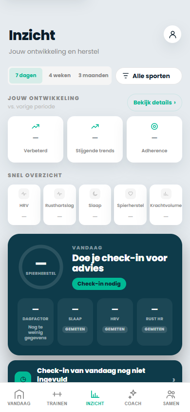
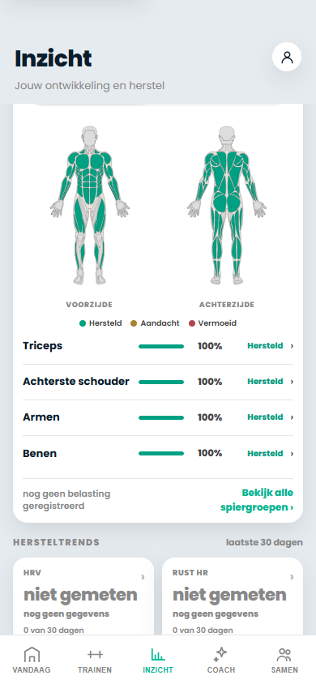
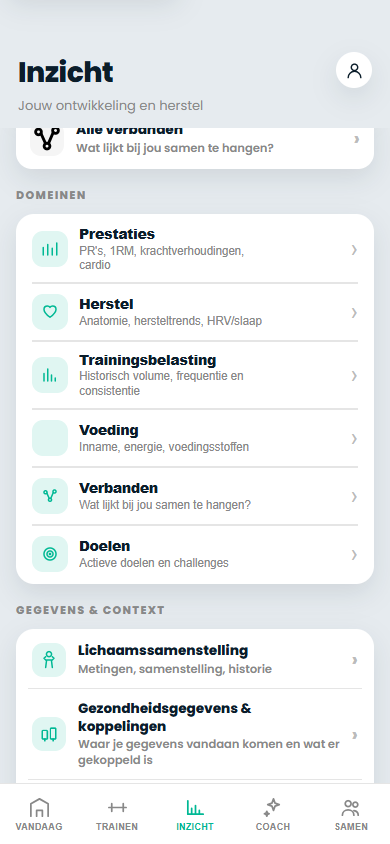

# Trainingskompas PR #594 — visuele acceptatie Inzicht V2

**Status:** concept ter beoordeling van de product owner. Deze screenshots komen uit een *offline, niet-ingelogde* Chrome-run op de geïsoleerde UX-branch. Er is geen echte sporter- of accountdata geladen. Onbekende waarden verschijnen bewust als '—' of 'niet gemeten'.

| Begin van Inzicht | Herstel en spierbelasting | Domeinen en gegevens |
|---|---|---|
|  |  |  |

## Te beoordelen

- Zijn de drie KPI's en de volgorde duidelijk?
- Is het herstelscherm compact genoeg, of zijn nog delen dubbelop?
- Vallen **Lichaamssamenstelling** en de vier contextacties logisch onder één kaart?
- Moet de navigatie visueel verder worden vereenvoudigd?

## Reeds geautomatiseerd gecontroleerd

- Geen horizontale overflow op 320, 360, 390, 430 px.
- Drie KPI's en zes domeinen renderen op elke gecontroleerde breedte.
- Alle vier contextacties bestaan en de route naar lichaamsmetingen werkt.
- Trainen blijft bereikbaar, trainingsritme wordt accountgebonden ververst en wist gegevens van een oud account direct bij switch.
- Deze screenshots tonen geen live synchronisatie, eigenaarshistorie of fysieke Android-toesteltest.

**Gates:** PR #594 blijft Draft. Geen merge naar `main`, geen Android-APK of publicatie van MoveKit-media vóór afzonderlijke acceptatie.
